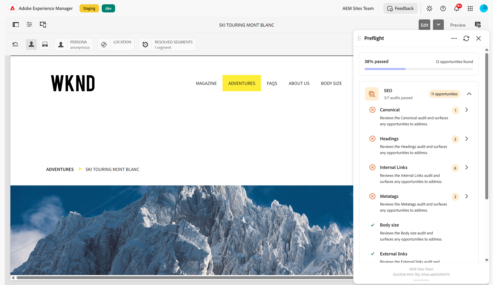

# Audits d’optimisation pour les moteurs de recherche

{align="center"}

La catégorie **SEO** dans Contrôle en amont regroupe les audits qui évaluent dans quelle mesure une page est optimisée pour les moteurs de recherche. Lorsque vous exécutez un audit de contrôle en amont, ces audits évaluent les métadonnées, la structure d’en-tête, les liens et le contenu de la page, ainsi que les opportunités de surface que vous pouvez examiner et résoudre avant de les publier.

Dans le tableau de bord des résultats, développez la catégorie **SEO** pour afficher chaque audit, s’il a été validé et le nombre d’opportunités trouvées. Sélectionnez un audit pour ouvrir sa page de détails et parcourir les opportunités. Pour savoir comment interpréter les résultats et résoudre les opportunités, voir [Résultats d’audit en contrôle en amont](../audit-results.md).

La catégorie SEO comprend les audits suivants :

* [Metatags](./seo/metatags.md) - Vérifie le titre de la page, la méta-description et l’en-tête H1.
* [En-têtes](./seo/headings.md) - Vérifie la structure et l’ordre des en-têtes de la page.
* [Liens internes](./seo/internal-links.md) - passe en revue les liens de la page qui renvoient à votre propre site.
* [Liens externes](./seo/external-links.md) - Passe en revue les liens de la page qui pointent vers d’autres sites.
* [Canonique](./seo/canonical.md) - Vérifie le lien canonique de la page.
* [Taille du corps](./seo/body-size.md) - Vérifie la quantité de contenu du corps sur la page.
* [Lorem ipsum](./seo/lorem-ipsum.md) - Détecte le texte d’espace réservé restant dans le contenu.
