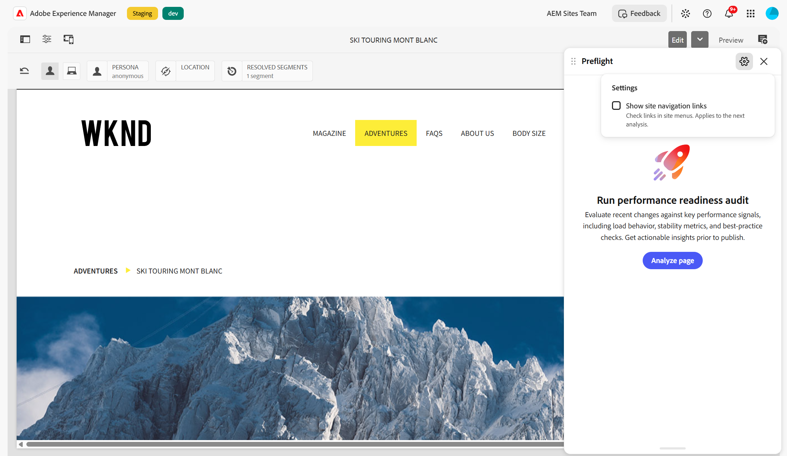

# Contrôle en amont - Audit des liens internes

L’audit **Liens internes** examine les liens de votre page qui renvoient à votre propre site. L’audit vérifie chaque lien interne de la page que vous modifiez et signale ceux qui sont rompus, non sécurisés ou orientés vers un emplacement qu’un visiteur ne peut pas suivre.

## Pourquoi est-ce important ?

Un lien interne rompu est une impasse pour le lecteur et une explore perdue pour un moteur de recherche, qui ne transmet aucune valeur à la page qu’il était censé atteindre. Les liens internes sont également les plus faciles à rompre par accident : une page est déplacée ou renommée et chaque lien vers celle-ci cesse de fonctionner en silence. Comme les liens se trouvent tous sur votre propre site, ce sont également ceux que vous pouvez corriger vous-même.

## Ce que l’audit vérifie

L’audit signale une opportunité pour chaque lien interne présentant l’un des problèmes suivants :

* **Lien rompu :** le lien renvoie une erreur, telle que `Status 403` ou `Status 404`, ou renvoie toujours `Status 500` ou `Status 501` après une nouvelle tentative de contrôle en amont. Un lien qui atteint l’erreur après une redirection est signalé de la même manière.
* **Lien non sécurisé :** le lien utilise `http://` au lieu de `https://`. Lorsque la version sécurisée de la même URL fonctionne, le contrôle en amont l’offre comme suggestion.
* **URL de l’éditeur :** le lien pointe vers une URL d’éditeur AEM au lieu de la page de contenu. Le lien fonctionne pour vous lors de la création, ce qui le rend facile à manquer, mais chaque visiteur accède à l’interface de création. Le contrôle en amont suggère l’URL de contenu.
* **Fragment manquant :** le lien pointe vers une ancre, telle que `#pricing`, que la page cible ne possède pas. La page s’ouvre toujours, mais le lecteur ou la lectrice arrive en haut de la page au lieu de la section que vous avez mentionnée, elle est donc moins grave qu’un lien rompu. Si la même ancre est mise en majuscules différemment dans la page, le contrôle en amont suggère l’ancre corrigée. Si la page cible elle-même est rompue, elle est signalée comme un **lien rompu** à la place.
* **Lien non vérifié :** la vérification a expiré ou a rencontré une erreur réseau, ou le lien a continué à renvoyer `Status 429` (trop de requêtes) ou une erreur serveur autre que `Status 500` ou `Status 501`, telle que `Status 503`. Le contrôle en amont ne peut pas déterminer si le lien fonctionne. Il vous demande donc de vérifier le lien vous-même plutôt que de le signaler comme rompu.

Un lien qui est résolu avec succès n’est pas marqué, même s’il comporte plusieurs redirections en cours de route. Il ne s’agit pas non plus d’un lien qui redirige vers un autre site, car il ne s’agit plus d’un lien interne.

## Comment les liens sont vérifiés

L’audit vérifie les liens de votre session de création afin qu’ils soient affichés tels que vous les avez connectés. Une page qui n’existe que sur l’instance de création est résolue correctement au lieu d’avoir l’air endommagée. Comme le site est en cours d’exécution et que vous êtes connecté, une erreur telle que `Status 403` ou `Status 500` signale un problème avec la page liée.

Les liens que le vérificateur de liens d’AEM a déjà marqués comme non valides sont inclus dans l’audit, même si l’éditeur supprime le lien cliquable de la page. Ils sont ensuite revérifiés au lieu d’être acceptés en confiance, de sorte qu’un lien qui a commencé à fonctionner depuis n’est pas signalé.

Lorsqu&#39;une vérification expire, atteint une erreur réseau ou renvoie `Status 429` ou une erreur de serveur, le contrôle en amont tente à nouveau d&#39;établir la liaison jusqu&#39;à deux fois. Aucun lien qui fonctionne lors d’une nouvelle tentative n’est signalé.

Une opportunité est signalée pour chaque emplacement où un lien s’affiche. Ainsi, un lien incorrect utilisé à trois endroits vous donne trois instances à corriger, chacune mettant en surbrillance sa propre place sur la page. Lorsque l’un de ces emplacements présente plusieurs problèmes, le contrôle en amont les présente ensemble sur une seule carte.

## Inclure les liens de navigation du site

Par défaut, l’audit des liens internes ignore les liens de navigation du site. Ces liens ne sont ni vérifiés ni signalés. La vérification d’un lien dans le corps de la page est toujours effectuée même si la même URL s’affiche également dans un menu.

Un lien est considéré comme une navigation si le lien lui-même ou un ancêtre est un élément `<nav>` ou a un attribut `role="navigation"`.

Pour inclure des liens de navigation dans la prochaine exécution d’audit :

1. Avant de commencer un audit ou une fois l’exécution terminée, ouvrez **Paramètres** (l’icône d’engrenage) dans l’en-tête de contrôle en amont. Si l’icône d’engrenage n’est pas visible, ouvrez **Autres actions** (**...**) et sélectionnez **Paramètres**.
1. Sélectionnez **Afficher les liens de navigation du site**.
1. Sélectionnez **Analyser la page** pour démarrer une exécution ou **Réanalyser** si les résultats sont déjà affichés.

{align="center"}

**Afficher les liens de navigation du site** contrôle les liens des contrôles d&#39;audit, et pas seulement les résultats affichés.

La modification du paramètre ne lance pas d’audit et ne modifie pas les résultats déjà affichés à l’écran. Lorsque ces résultats utilisaient un paramètre différent, un point s&#39;affiche sur **Réanalyser**, avec le libellé **Réanalyser pour appliquer de nouveaux paramètres**. Exécutez à nouveau les audits pour appliquer la modification ou restaurez le paramètre précédent pour effacer le point.

Le contrôle en amont enregistre le paramètre dans votre navigateur et le conserve une fois que vous vous êtes déconnecté. Les onglets d’un même site partagent le paramètre. Pour ignorer à nouveau les liens de navigation, effacez **Afficher les liens de navigation du site** avant la prochaine exécution.

Le paramètre n’est pas disponible pendant l’exécution des audits.

## Filtrer les résultats

Sur la page de détails, utilisez le filtre en regard de l’en-tête **Instances** pour n’afficher que certaines des opportunités :

| Filtrer | Opportunités affichées |
|---|---|
| **Tous** (par défaut) | Chaque opportunité |
| **Cassé** | Liens rompus et URL de l’éditeur |
| **Vérification requise** | Liens non sécurisés, fragments manquants et liens non vérifiés |

Un lien `http://` non sécurisé dont la version `https://` est rompue comporte deux opportunités sur la même carte. **Rompu** affiche uniquement l’opportunité de lien rompu, et **Nécessite une vérification** affiche uniquement l’opportunité de lien non sécurisé. Pour plus d’informations, voir [Filtrer les instances](../../audit-results.md#filter-instances).

## Limites connues

L’audit s’exécute dans l’éditeur de page d’AEM Sites, dans Adobe Managed Services (AMS) et dans la création basée sur des documents via Sidekick. Il n’est actuellement pas disponible dans l’éditeur universel.

## Comment résoudre

Lorsque l&#39;audit trouve des opportunités, chacune d&#39;elles décrit le problème et le changement recommandé, et identifie le lien impliqué. Utilisez **Mettre en surbrillance sur la page** pour accéder au lien dans votre contenu et utilisez la section **URL actuelle** pour copier l’URL ou l’ouvrir dans un nouvel onglet afin de confirmer le problème par vous-même. Pour savoir comment examiner et résoudre les opportunités, consultez [Résultats d’audit dans le contrôle en amont](../../audit-results.md).
